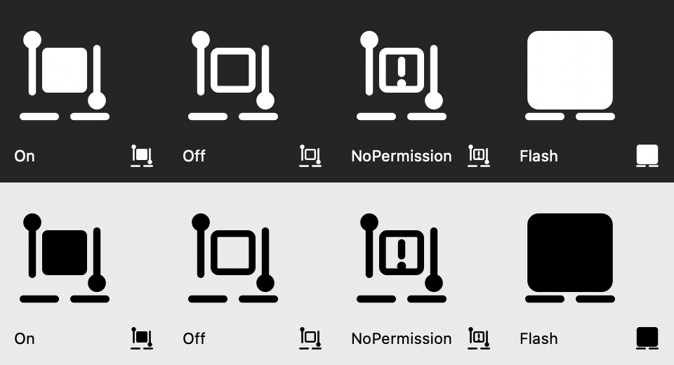

# Grab

Copy-on-select for macOS: text you select with the mouse goes straight to the clipboard, except in apps you exclude.

Terminals have done this for decades. Grab brings the same habit to every other app: drag across a sentence, double-click a word or triple-click a line, and it is already on the clipboard — no ⌘C.



## Features

- **Lives in the menu bar.** No Dock icon, no windows in your way.
- **Mouse selections only.** Drag forward (4 pt or more, left to right or down the page), double-click and triple-click. A backward drag — right to left or up — only selects, so you can highlight text without touching the clipboard. Keyboard selections are left alone.
- **Exclude list.** Grab stays out of apps you list by bundle ID. Add a running app or pick any `.app`. Terminals with their own copy-on-select (agterm, Ghostty, Terminal, iTerm2), Finder, 1Password and Keychain Access are excluded by default.
- **Plain text, marked as automatic.** Grab writes plain text and tags it `org.nspasteboard.AutoGeneratedType`, so clipboard managers that honour the [nspasteboard.org](http://nspasteboard.org) convention can tell it from a manual copy.
- **Quiet.** Empty selections, single characters and text already on the clipboard are skipped. A successful copy only flashes the menu bar icon — no sounds, no pop-ups.
- **Launch at login**, English and Ukrainian interface, no third-party dependencies.

## How it works

On mouse-up Grab asks the frontmost app for its selected text through the macOS Accessibility API. When an app does not expose its selection that way, Grab falls back to sending ⌘C — but not when a list, table or outline has focus, so opening an item never replaces your clipboard. If that fallback copies text Grab would have skipped, the previous clipboard contents are restored.

## Requirements

- macOS 27 or later
- Xcode 27 to build
- The **Accessibility** permission (System Settings → Privacy & Security → Accessibility). Grab asks for it on first launch and starts working as soon as it is granted.

## Build and run

There are no prebuilt releases yet. Build it yourself:

```sh
git clone git@github.com:KYONY/grab.git
cd grab
make run      # build and launch
make test     # unit tests + localization check
```

The project signs with Xcode's automatic signing. To build under your own Apple ID, change `DEVELOPMENT_TEAM` in `Grab.xcodeproj` to your team ID. Keep a stable signing identity: macOS ties the Accessibility permission to the app's signature, so an ad-hoc signed build loses it on every rebuild.

## Usage

Click the menu bar icon to turn Grab on or off, open **Settings…** to edit the Exclude list and launch-at-login, or quit.

| Icon state | Meaning |
|---|---|
| Filled selection | On |
| Outlined selection | Off |
| Outline with `!` | Accessibility permission missing |
| Solid square (brief) | Text was just copied |

## Known limitations

- A triple-click copies twice: first the word (from the double-click), then the line. The clipboard ends up with the line, but clipboard history tools show both.
- Apps that expose neither their selection nor a focused element through Accessibility get the ⌘C fallback whenever a selection gesture is detected.

## License

[MIT](LICENSE)
